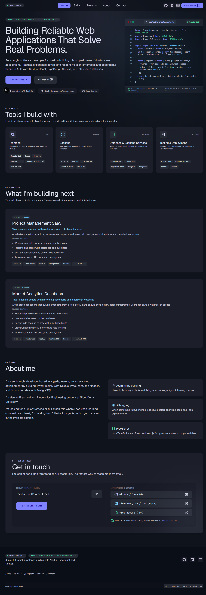

# Portfolio

Personal portfolio site for Tariladei Doutua, a self-taught developer looking for junior frontend and full-stack roles.

**Live site:** https://my-portfolio-rosy-theta-54.vercel.app/



## About this project

A single-page portfolio with sections for skills, projects, about, and contact.
There is no backend: all content lives in typed data files, so updating the site means editing data, not components.

## Tech stack

- Next.js 16 (App Router) with TypeScript
- Tailwind CSS v4
- lucide-react icons, sonner toasts
- Geist and JetBrains Mono via `next/font`
- Deployed on Vercel

## Features

- Responsive layout for mobile, tablet, and desktop
- Dark theme with a design-token system in the Tailwind theme
- Mobile navigation panel that closes with the Escape key
- Copy-to-clipboard email button with success and error feedback
- Smooth-scroll navigation, disabled for users who prefer reduced motion

## Getting started

```bash
git clone https://github.com/T-tech26/my-portfolio.git
cd my-portfolio
npm install
npm run dev
```

Open http://localhost:3000.

Other scripts: `npm run build`, `npm run lint`.

## Project structure

```
src/
  app/          Routes, layout, global styles and theme tokens
  components/   ui/ (Button, Chip), layouts/ (cards), sections/
  data/         Content: skills, projects, about, links
  types/        Shared TypeScript types
  utils/        Helpers such as cn() and accent styles
```

## Design and implementation decisions

- **Design first, then code.** The UI was designed in Google Stitch. I
  converted the exported HTML into components instead of pasting it, and moved its colors, spacing, and type scale into Tailwind theme tokens.
- **Content in typed data files.** Skills, projects, and links are arrays in `src/data`, typed in `src/types`. Components only render data.
- **Server components by default.** Only the interactive parts (mobile nav, copy button) are client components, to keep client JavaScript small.
- **Projects labelled honestly.** Both projects are marked "Planned" with design previews. Nothing is presented as built until it exists.
- **No backend.** A portfolio doesn't need one, so I kept it static.

## Accessibility

- Skip link and a `<main>` landmark
- Semantic lists and labelled navigation landmarks
- Mobile menu exposes its open/closed state with `aria-expanded`
- Animations and smooth scrolling respect `prefers-reduced-motion`
- External links announce that they open in a new tab
- Decorative icons are hidden from assistive technology

## Roadmap

- [ ] Build Project 1: Project Management SaaS
- [ ] Build Project 2: Market Analytics Dashboard
- [ ] Replace design previews with real screenshots
- [ ] Add resume PDF

## Contact

Tariladei Doutua · [taridoutua341@gmail.com](mailto:taridoutua341@gmail.com) · [GitHub](https://github.com/T-tech26) · [LinkedIn](https://linkedin.com/in/taridoutua)